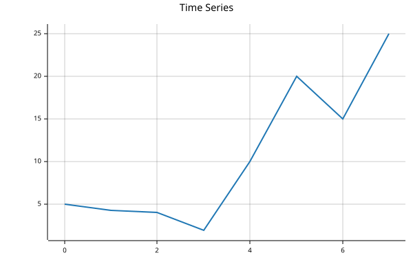
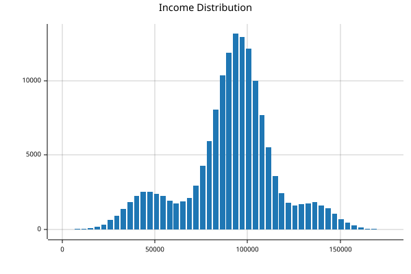

# BasedTab


<!-- WARNING: THIS FILE WAS AUTOGENERATED! DO NOT EDIT! -->

## Usage

### Installation

For development:

``` bash
git clone https://github.com/AnswerDotAI/basedtab.git
pip install -e .
```

Install latest from the GitHub [repository](https://github.com/AnswerDotAI/basedtab):

``` sh
$ pip install git+https://github.com/AnswerDotAI/basedtab.git
```

or from [conda](https://anaconda.org/AnswerDotAI/basedtab)

``` sh
$ conda install -c AnswerDotAI basedtab
```

or from [pypi](https://pypi.org/project/basedtab)

``` sh
$ pip install basedtab
```

## How to use

### Load data

`read_csv` and `save_csv`

``` python
from basedtab.core import *
from nbdev.config import get_config

data_path = str(get_config().config_path/'data/toy.csv')
bf = BFrame.read_csv(data_path)
bf.head(3).df
```

<div>
<style scoped>
    .dataframe tbody tr th:only-of-type {
        vertical-align: middle;
    }
&#10;    .dataframe tbody tr th {
        vertical-align: top;
    }
&#10;    .dataframe thead th {
        text-align: right;
    }
</style>

|     | Number | City   | Gender | Age | Income  | Illness |
|-----|--------|--------|--------|-----|---------|---------|
| 0   | 1      | Dallas | Male   | 41  | 40367.0 | No      |
| 1   | 2      | Dallas | Male   | 54  | 45084.0 | No      |
| 2   | 3      | Dallas | Male   | 42  | 52483.0 | No      |

</div>

### Groupby

``` python
from basedpl import add, tally, square
MEAN = add.reduce_first / tally
bf.groupby("City", "Income", mean=MEAN).df.astype(int)
```

<div>
<style scoped>
    .dataframe tbody tr th:only-of-type {
        vertical-align: middle;
    }
&#10;    .dataframe tbody tr th {
        vertical-align: top;
    }
&#10;    .dataframe thead th {
        text-align: right;
    }
</style>

|                 |      | Income |
|-----------------|------|--------|
| Dallas          | mean | 45252  |
| New York City   | mean | 96857  |
| Los Angeles     | mean | 95264  |
| Mountain View   | mean | 135078 |
| Boston          | mean | 91554  |
| Washington D.C. | mean | 70991  |
| San Diego       | mean | 100756 |
| Austin          | mean | 90277  |

</div>

``` python
RMSE = MEAN.under(square)
bf.head(100).groupby("Gender", ["Age", "Income"], mean=MEAN, rmse=RMSE)
```

    ┌→───────────────────────────┐
    ↓"Male"⌷                     │
    ↓             Age      Income│
    │mean 44.57407407 48301.42593│
    │rmse 45.66970793 49632.10639│
    │                            │
    │"Female"⌷                   │
    │             Age      Income│
    │mean 45.30434783 39739.36957│
    │rmse 46.73468128 40738.65853│
    └~───────────────────────────┘

### Rolling

``` python
ts = BFrame(dict(price=[5,4.3,4.1,2,10,20,15,25]))
ts
```

    ┌→────────────────────────────────┐
    │ price:┌→──────────────────────┐ │
    │       │5 4.3 4.1 2 10 20 15 25│ │
    │       └~──────────────────────┘ │
    └∊────────────────────────────────┘

``` python
ts.rolling("price", size=3, edge="clamp", mean=MEAN).df
```

<div>
<style scoped>
    .dataframe tbody tr th:only-of-type {
        vertical-align: middle;
    }
&#10;    .dataframe tbody tr th {
        vertical-align: top;
    }
&#10;    .dataframe thead th {
        text-align: right;
    }
</style>

|     |      | price     |
|-----|------|-----------|
| 0   | mean | 4.766667  |
| 1   | mean | 4.466667  |
| 2   | mean | 3.466667  |
| 3   | mean | 5.366667  |
| 4   | mean | 10.666667 |
| 5   | mean | 15.000000 |
| 6   | mean | 20.000000 |
| 7   | mean | 21.666667 |

</div>

``` python
ts.rolling("price", size=2, step=2, mean=MEAN, rmse=RMSE).df
```

<div>
<style scoped>
    .dataframe tbody tr th:only-of-type {
        vertical-align: middle;
    }
&#10;    .dataframe tbody tr th {
        vertical-align: top;
    }
&#10;    .dataframe thead th {
        text-align: right;
    }
</style>

|     |      | price     |
|-----|------|-----------|
| 0   | mean | 4.650000  |
|     | rmse | 4.663153  |
| 1   | mean | 3.050000  |
|     | rmse | 3.225678  |
| 2   | mean | 15.000000 |
|     | rmse | 15.811388 |
| 3   | mean | 20.000000 |
|     | rmse | 20.615528 |

</div>

### Plot

``` python
ts.plot(title="Time Series")
```



``` python
bf["Income"].hist(title="Income Distribution")
```


