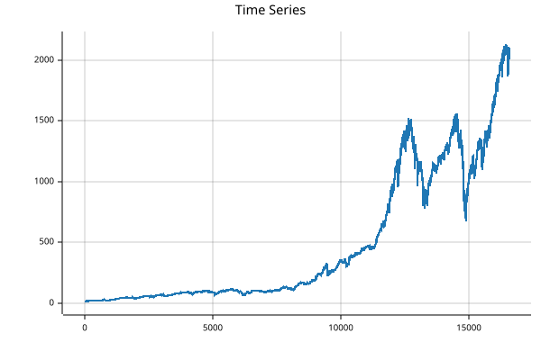
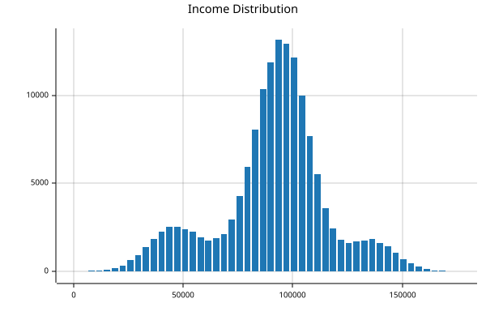

# BasedTab


<!-- WARNING: THIS FILE WAS AUTOGENERATED! DO NOT EDIT! -->

## Usage

### Installation

Not on PyPI yet. Install:

``` bash
git clone https://github.com/AnswerDotAI/basedtab.git
pip install -e .
```

## How to use

### Load data

`read_csv` and `save_csv`

``` python
from basedtab.core import BFrame

bf = BFrame.read_csv(toy_path)
bf.head(2)
```

    ["Number":[1 2]ₓ "City":["Dallas" "Dallas"] "Gender":["Male" "Male"] "Age":[41 54]ₓ "Income":[40367 45084] "Illness":["No" "No"]]

``` python
# Conversion to Pandas
df = bf.df 
df.head(2)
```

<div>
<style scoped>
    .dataframe tbody tr th:only-of-type {
        vertical-align: middle;
    }
&#10;    .dataframe tbody tr th {
        vertical-align: top;
    }
&#10;    .dataframe thead th {
        text-align: right;
    }
</style>

|     | Number | City   | Gender | Age | Income  | Illness |
|-----|--------|--------|--------|-----|---------|---------|
| 0   | 1      | Dallas | Male   | 41  | 40367.0 | No      |
| 1   | 2      | Dallas | Male   | 54  | 45084.0 | No      |

</div>

``` python
inc = bf["Income"]
inc.mean, inc.std, inc.skew, inc.kurt, inc.moment(5)
```

    (Array(91252.79827333333),
     Array(24989.417649879582),
     Array(-0.3336387312149909),
     Array(3.5203677711666033),
     Array(-1.9377651398953264))

### Groupby

``` python
from basedpl import add, tally, square
MEAN = add.reduce_first / tally
bf.groupby("City", "Income", mean=MEAN)
```

    "Dallas"⌷
              Income
    mean 45252.23119

    "New York City"⌷
              Income
    mean 96857.13139

    "Los Angeles"⌷
              Income
    mean 95264.15541

    "Mountain View"⌷
              Income
    mean 135078.4158

    "Boston"⌷
             Income
    mean 91554.5715

    "Washington D.C."⌷
              Income
    mean 70991.61281

    "San Diego"⌷
              Income
    mean 100756.2092

    "Austin"⌷
              Income
    mean 90277.51342

``` python
RMSE = MEAN.under(square)
bf.groupby("Gender", ["Age", "Income"], mean=MEAN, rmse=RMSE)
```

    "Male"⌷
                 Age      Income
    mean  44.9126253  95670.2472
    rmse 46.37557969 98752.06754

    "Female"⌷
                 Age      Income
    mean 44.99776435 85660.92184
    rmse 46.46704189 89097.22374

### Rolling

``` python
ts = BFrame.read_csv(sp_path)
ts.head(2)
```

    ["index":[16606 16605]ₓ "date":["1950-01-03" "1950-01-04"] "open":[16.66 16.85] "high":[16.66 16.85] "low":[16.66 16.85] "close":[16.66 16.85] "volume":[1260000 1890000]ₓ "adj_close":[16.66 16.85]]

``` python
ts_df = ts.df
ts_df.head(2)
```

<div>
<style scoped>
    .dataframe tbody tr th:only-of-type {
        vertical-align: middle;
    }
&#10;    .dataframe tbody tr th {
        vertical-align: top;
    }
&#10;    .dataframe thead th {
        text-align: right;
    }
</style>

|     | index | date       | open  | high  | low   | close | volume  | adj_close |
|-----|-------|------------|-------|-------|-------|-------|---------|-----------|
| 0   | 16606 | 1950-01-03 | 16.66 | 16.66 | 16.66 | 16.66 | 1260000 | 16.66     |
| 1   | 16605 | 1950-01-04 | 16.85 | 16.85 | 16.85 | 16.85 | 1890000 | 16.85     |

</div>

``` python
ts.rolling("close", size=3, edge="clamp", mean=MEAN)[:5]
```

    0⌷
               close
    mean 16.72333333

    1⌷
               close
    mean 16.81333333

    2⌷
         close
    mean 16.92

    3⌷
               close
    mean 16.99666667

    4⌷
         close
    mean 17.03

``` python
ts.rolling("close", size=2, step=2, mean=MEAN, rmse=RMSE)[:5]
```

    0⌷
               close
    mean      16.755
    rmse 16.75526932

    1⌷
               close
    mean      16.955
    rmse 16.95501843

    2⌷
               close
    mean      17.055
    rmse 17.05501832

    3⌷
               close
    mean      16.925
    rmse 16.92580426

    4⌷
               close
    mean      16.695
    rmse 16.69501872

### Plot

``` python
ts["close"].plot(title="Time Series")
```



``` python
bf["Income"].hist(title="Income Distribution")
```


