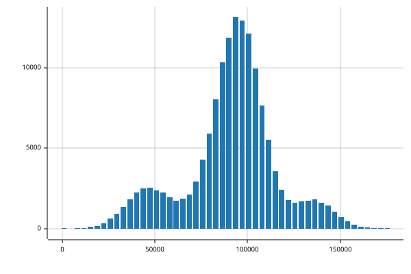

# BasedTab


<!-- WARNING: THIS FILE WAS AUTOGENERATED! DO NOT EDIT! -->

## Usage

### Installation

For development:

``` bash
git clone https://github.com/AnswerDotAI/basedtab.git
pip install -e .
```

Install latest from the GitHub [repository](https://github.com/AnswerDotAI/basedtab):

``` sh
$ pip install git+https://github.com/AnswerDotAI/basedtab.git
```

or from [conda](https://anaconda.org/AnswerDotAI/basedtab)

``` sh
$ conda install -c AnswerDotAI basedtab
```

or from [pypi](https://pypi.org/project/basedtab)

``` sh
$ pip install basedtab
```

## How to use

``` python
from basedtab.core import *
bf = BFrame.read_csv("../../data/toy.csv")
bf.head(3).df
```

<div>
<style scoped>
    .dataframe tbody tr th:only-of-type {
        vertical-align: middle;
    }
&#10;    .dataframe tbody tr th {
        vertical-align: top;
    }
&#10;    .dataframe thead th {
        text-align: right;
    }
</style>

|     | Number | City   | Gender | Age | Income  | Illness |
|-----|--------|--------|--------|-----|---------|---------|
| 0   | 1      | Dallas | Male   | 41  | 40367.0 | No      |
| 1   | 2      | Dallas | Male   | 54  | 45084.0 | No      |
| 2   | 3      | Dallas | Male   | 42  | 52483.0 | No      |

</div>

``` python
from basedpl import add, tally, square
MEAN = add.reduce_first / tally
bf.groupby("City", "Income", mean=MEAN).df.astype(int)
```

<div>
<style scoped>
    .dataframe tbody tr th:only-of-type {
        vertical-align: middle;
    }
&#10;    .dataframe tbody tr th {
        vertical-align: top;
    }
&#10;    .dataframe thead th {
        text-align: right;
    }
</style>

|     |      | Income |
|-----|------|--------|
| 0   | mean | 45252  |
| 1   | mean | 96857  |
| 2   | mean | 95264  |
| 3   | mean | 135078 |
| 4   | mean | 91554  |
| 5   | mean | 70991  |
| 6   | mean | 100756 |
| 7   | mean | 90277  |

</div>

``` python
RMSE = MEAN.under(square)
bf.head(100).groupby("Gender", ["Age", "Income"], mean=MEAN, rmse=RMSE)
```

    ┌→───────────────────────────┐
    ↓0⌷                          │
    ↓             Age      Income│
    │mean 44.57407407 48301.42593│
    │rmse 45.66970793 49632.10639│
    │                            │
    │1⌷                          │
    │             Age      Income│
    │mean 45.30434783 39739.36957│
    │rmse 46.73468128 40738.65853│
    └~───────────────────────────┘

``` python
bf["Income"].hist()
```


