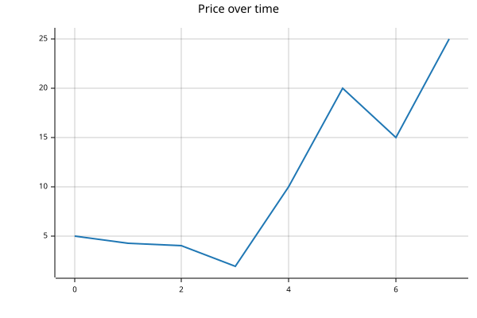

# core


<!-- WARNING: THIS FILE WAS AUTOGENERATED! DO NOT EDIT! -->

# BFrame

------------------------------------------------------------------------

<a
href="https://github.com/AnswerDotAI/BasedTab/blob/main/basedtab/core.py#L20"
target="_blank" style="float:right; font-size:smaller">source</a>

### BFrame

``` python
def BFrame(
    *values, keys:NoneType=None, names:NoneType=None, **fields
):
```

*A native BPL value with shape, keys and names. An array that holds a
function as a direct item is a `FunctionArray`.*

``` python
test_frame = BFrame(dict(col=[1,2,3]))
test_frame
```

    ┌→────────────┐
    │ col:┌→────┐ │
    │     │1 2 3│ │
    │     └ₓ────┘ │
    └∊────────────┘

``` python
test_eq(BFrame, type(test_frame))
```

------------------------------------------------------------------------

<a
href="https://github.com/AnswerDotAI/BasedTab/blob/main/basedtab/core.py#L24"
target="_blank" style="float:right; font-size:smaller">source</a>

### BFrame.\_\_getitem\_\_

``` python
def __getitem__(
    i
):
```

*Select by positions, keys, slices or per-axis masks. `None` inserts an
axis and `...` keeps omitted axes.*

``` python
test_eq(BFrame, type(test_frame[0]))
```

## Reading and writing

### CSV

------------------------------------------------------------------------

<a
href="https://github.com/AnswerDotAI/BasedTab/blob/main/basedtab/core.py#L28"
target="_blank" style="float:right; font-size:smaller">source</a>

### BFrame.read_csv

``` python
def read_csv(
    path, **kwargs
):
```

``` python
bf = BFrame.read_csv("../data/toy.csv", encoding="UTF-8")
test_eq(BFrame, type(bf))
bf.df.head(2)
```

<div>
<style scoped>
    .dataframe tbody tr th:only-of-type {
        vertical-align: middle;
    }
&#10;    .dataframe tbody tr th {
        vertical-align: top;
    }
&#10;    .dataframe thead th {
        text-align: right;
    }
</style>

<table class="dataframe" data-quarto-postprocess="true" data-border="1">
<thead>
<tr style="text-align: right;">
<th data-quarto-table-cell-role="th"></th>
<th data-quarto-table-cell-role="th">Number</th>
<th data-quarto-table-cell-role="th">City</th>
<th data-quarto-table-cell-role="th">Gender</th>
<th data-quarto-table-cell-role="th">Age</th>
<th data-quarto-table-cell-role="th">Income</th>
<th data-quarto-table-cell-role="th">Illness</th>
</tr>
</thead>
<tbody>
<tr>
<td data-quarto-table-cell-role="th">0</td>
<td>1</td>
<td>Dallas</td>
<td>Male</td>
<td>41</td>
<td>40367.0</td>
<td>No</td>
</tr>
<tr>
<td data-quarto-table-cell-role="th">1</td>
<td>2</td>
<td>Dallas</td>
<td>Male</td>
<td>54</td>
<td>45084.0</td>
<td>No</td>
</tr>
</tbody>
</table>

</div>

------------------------------------------------------------------------

<a
href="https://github.com/AnswerDotAI/BasedTab/blob/main/basedtab/core.py#L32"
target="_blank" style="float:right; font-size:smaller">source</a>

### BFrame.save_csv

``` python
def save_csv(
    path
):
```

``` python
# bf.save_csv("../data/save_test.csv");
```

## Selection

------------------------------------------------------------------------

<a
href="https://github.com/AnswerDotAI/BasedTab/blob/main/basedtab/core.py#L36"
target="_blank" style="float:right; font-size:smaller">source</a>

### BFrame.head

``` python
def head(
    n:int=5
):
```

``` python
test_eq(BFrame, type(bf.head()))
head = bf.head(100)
head.head(2).df
```

<div>
<style scoped>
    .dataframe tbody tr th:only-of-type {
        vertical-align: middle;
    }
&#10;    .dataframe tbody tr th {
        vertical-align: top;
    }
&#10;    .dataframe thead th {
        text-align: right;
    }
</style>

<table class="dataframe" data-quarto-postprocess="true" data-border="1">
<thead>
<tr style="text-align: right;">
<th data-quarto-table-cell-role="th"></th>
<th data-quarto-table-cell-role="th">Number</th>
<th data-quarto-table-cell-role="th">City</th>
<th data-quarto-table-cell-role="th">Gender</th>
<th data-quarto-table-cell-role="th">Age</th>
<th data-quarto-table-cell-role="th">Income</th>
<th data-quarto-table-cell-role="th">Illness</th>
</tr>
</thead>
<tbody>
<tr>
<td data-quarto-table-cell-role="th">0</td>
<td>1</td>
<td>Dallas</td>
<td>Male</td>
<td>41</td>
<td>40367.0</td>
<td>No</td>
</tr>
<tr>
<td data-quarto-table-cell-role="th">1</td>
<td>2</td>
<td>Dallas</td>
<td>Male</td>
<td>54</td>
<td>45084.0</td>
<td>No</td>
</tr>
</tbody>
</table>

</div>

------------------------------------------------------------------------

<a
href="https://github.com/AnswerDotAI/BasedTab/blob/main/basedtab/core.py#L40"
target="_blank" style="float:right; font-size:smaller">source</a>

### BFrame.tail

``` python
def tail(
    n:int=5
):
```

``` python
test_eq(BFrame, type(bf.tail()))
bf.tail(2).df
```

<div>
<style scoped>
    .dataframe tbody tr th:only-of-type {
        vertical-align: middle;
    }
&#10;    .dataframe tbody tr th {
        vertical-align: top;
    }
&#10;    .dataframe thead th {
        text-align: right;
    }
</style>

<table class="dataframe" data-quarto-postprocess="true" data-border="1">
<thead>
<tr style="text-align: right;">
<th data-quarto-table-cell-role="th"></th>
<th data-quarto-table-cell-role="th">Number</th>
<th data-quarto-table-cell-role="th">City</th>
<th data-quarto-table-cell-role="th">Gender</th>
<th data-quarto-table-cell-role="th">Age</th>
<th data-quarto-table-cell-role="th">Income</th>
<th data-quarto-table-cell-role="th">Illness</th>
</tr>
</thead>
<tbody>
<tr>
<td data-quarto-table-cell-role="th">0</td>
<td>149999</td>
<td>Austin</td>
<td>Male</td>
<td>25</td>
<td>111878.0</td>
<td>No</td>
</tr>
<tr>
<td data-quarto-table-cell-role="th">1</td>
<td>150000</td>
<td>Austin</td>
<td>Female</td>
<td>37</td>
<td>87251.0</td>
<td>No</td>
</tr>
</tbody>
</table>

</div>

## Groupby

``` python
display(agg)
display(gfan)
display(rfan)
```

    {(↑⍺)⍠0 ⍵}⍤[0 ∞]

    ↣(□, {(↑⍺)⍠0 ⍵}⍤[0 ∞])

    ↣(□, {(↑⍺)⍠0 ⍵}⍤[0 ∞]⍤[∞ 2])

------------------------------------------------------------------------

<a
href="https://github.com/AnswerDotAI/BasedTab/blob/main/basedtab/core.py#L50"
target="_blank" style="float:right; font-size:smaller">source</a>

### BFrame.matrix

``` python
def matrix(
    cols
)->basedpl.Array:
```

``` python
head.matrix("Age")[:2]
```

    ┌→──┐
    ↓Age│
    │ 41│
    │ 54│
    └ₓ──┘

------------------------------------------------------------------------

<a
href="https://github.com/AnswerDotAI/BasedTab/blob/main/basedtab/core.py#L54"
target="_blank" style="float:right; font-size:smaller">source</a>

### BFrame.groupby

``` python
def groupby(
    by, cols, **aggs
):
```

``` python
MEAN = add.reduce / tally
RMSE = MEAN.under(square)
fn_dict=dict(mean=MEAN, rmse=RMSE)
fn_dict
```

    {'mean': +/÷≢, 'rmse': (+/÷≢)@⊼}

``` python
head.groupby("Gender", "Income", mean=MEAN).df
```

<div>
<style scoped>
    .dataframe tbody tr th:only-of-type {
        vertical-align: middle;
    }
&#10;    .dataframe tbody tr th {
        vertical-align: top;
    }
&#10;    .dataframe thead th {
        text-align: right;
    }
</style>

<table class="dataframe" data-quarto-postprocess="true" data-border="1">
<thead>
<tr style="text-align: right;">
<th data-quarto-table-cell-role="th"></th>
<th data-quarto-table-cell-role="th"></th>
<th data-quarto-table-cell-role="th">Income</th>
</tr>
</thead>
<tbody>
<tr>
<td data-quarto-table-cell-role="th">Male</td>
<td data-quarto-table-cell-role="th">mean</td>
<td>48301.425926</td>
</tr>
<tr>
<td data-quarto-table-cell-role="th">Female</td>
<td data-quarto-table-cell-role="th">mean</td>
<td>39739.369565</td>
</tr>
</tbody>
</table>

</div>

``` python
head.groupby("Gender", ["Age", "Income"], **fn_dict).df
```

<div>
<style scoped>
    .dataframe tbody tr th:only-of-type {
        vertical-align: middle;
    }
&#10;    .dataframe tbody tr th {
        vertical-align: top;
    }
&#10;    .dataframe thead th {
        text-align: right;
    }
</style>

<table class="dataframe" data-quarto-postprocess="true" data-border="1">
<thead>
<tr style="text-align: right;">
<th data-quarto-table-cell-role="th"></th>
<th data-quarto-table-cell-role="th"></th>
<th data-quarto-table-cell-role="th">Age</th>
<th data-quarto-table-cell-role="th">Income</th>
</tr>
</thead>
<tbody>
<tr>
<td rowspan="2" data-quarto-table-cell-role="th"
data-valign="top">Male</td>
<td data-quarto-table-cell-role="th">mean</td>
<td>44.574074</td>
<td>48301.425926</td>
</tr>
<tr>
<td data-quarto-table-cell-role="th">rmse</td>
<td>45.669708</td>
<td>49632.106391</td>
</tr>
<tr>
<td rowspan="2" data-quarto-table-cell-role="th"
data-valign="top">Female</td>
<td data-quarto-table-cell-role="th">mean</td>
<td>45.304348</td>
<td>39739.369565</td>
</tr>
<tr>
<td data-quarto-table-cell-role="th">rmse</td>
<td>46.734681</td>
<td>40738.658528</td>
</tr>
</tbody>
</table>

</div>

## Rolling

`windows` docs with arg explanations:
https://answerdotai.github.io/basedpl/glyphs/up-down-arrow.html

------------------------------------------------------------------------

<a
href="https://github.com/AnswerDotAI/BasedTab/blob/main/basedtab/core.py#L61"
target="_blank" style="float:right; font-size:smaller">source</a>

### BFrame.rolling

``` python
def rolling(
    cols, size, edge:str='fill', step:int=1, fill:int=0, **aggs
):
```

``` python
ts = BFrame(dict(price=[5,4.3,4.1,2,10,20,15,25]))
ts.rolling("price", size=3, mean=MEAN).df
```

<div>
<style scoped>
    .dataframe tbody tr th:only-of-type {
        vertical-align: middle;
    }
&#10;    .dataframe tbody tr th {
        vertical-align: top;
    }
&#10;    .dataframe thead th {
        text-align: right;
    }
</style>

<table class="dataframe" data-quarto-postprocess="true" data-border="1">
<thead>
<tr style="text-align: right;">
<th data-quarto-table-cell-role="th"></th>
<th data-quarto-table-cell-role="th"></th>
<th data-quarto-table-cell-role="th">price</th>
</tr>
</thead>
<tbody>
<tr>
<td data-quarto-table-cell-role="th">0</td>
<td data-quarto-table-cell-role="th">mean</td>
<td>3.100000</td>
</tr>
<tr>
<td data-quarto-table-cell-role="th">1</td>
<td data-quarto-table-cell-role="th">mean</td>
<td>4.466667</td>
</tr>
<tr>
<td data-quarto-table-cell-role="th">2</td>
<td data-quarto-table-cell-role="th">mean</td>
<td>3.466667</td>
</tr>
<tr>
<td data-quarto-table-cell-role="th">3</td>
<td data-quarto-table-cell-role="th">mean</td>
<td>5.366667</td>
</tr>
<tr>
<td data-quarto-table-cell-role="th">4</td>
<td data-quarto-table-cell-role="th">mean</td>
<td>10.666667</td>
</tr>
<tr>
<td data-quarto-table-cell-role="th">5</td>
<td data-quarto-table-cell-role="th">mean</td>
<td>15.000000</td>
</tr>
<tr>
<td data-quarto-table-cell-role="th">6</td>
<td data-quarto-table-cell-role="th">mean</td>
<td>20.000000</td>
</tr>
<tr>
<td data-quarto-table-cell-role="th">7</td>
<td data-quarto-table-cell-role="th">mean</td>
<td>13.333333</td>
</tr>
</tbody>
</table>

</div>

``` python
ts.rolling("price", size=5, step=2, mean=MEAN, rmse=RMSE).df
```

<div>
<style scoped>
    .dataframe tbody tr th:only-of-type {
        vertical-align: middle;
    }
&#10;    .dataframe tbody tr th {
        vertical-align: top;
    }
&#10;    .dataframe thead th {
        text-align: right;
    }
</style>

<table class="dataframe" data-quarto-postprocess="true" data-border="1">
<thead>
<tr style="text-align: right;">
<th data-quarto-table-cell-role="th"></th>
<th data-quarto-table-cell-role="th"></th>
<th data-quarto-table-cell-role="th">price</th>
</tr>
</thead>
<tbody>
<tr>
<td rowspan="2" data-quarto-table-cell-role="th"
data-valign="top">0</td>
<td data-quarto-table-cell-role="th">mean</td>
<td>2.680000</td>
</tr>
<tr>
<td data-quarto-table-cell-role="th">rmse</td>
<td>3.472751</td>
</tr>
<tr>
<td rowspan="2" data-quarto-table-cell-role="th"
data-valign="top">1</td>
<td data-quarto-table-cell-role="th">mean</td>
<td>5.080000</td>
</tr>
<tr>
<td data-quarto-table-cell-role="th">rmse</td>
<td>5.732364</td>
</tr>
<tr>
<td rowspan="2" data-quarto-table-cell-role="th"
data-valign="top">2</td>
<td data-quarto-table-cell-role="th">mean</td>
<td>10.220000</td>
</tr>
<tr>
<td data-quarto-table-cell-role="th">rmse</td>
<td>12.213190</td>
</tr>
<tr>
<td rowspan="2" data-quarto-table-cell-role="th"
data-valign="top">3</td>
<td data-quarto-table-cell-role="th">mean</td>
<td>14.000000</td>
</tr>
<tr>
<td data-quarto-table-cell-role="th">rmse</td>
<td>16.431677</td>
</tr>
</tbody>
</table>

</div>

## Viz

------------------------------------------------------------------------

<a
href="https://github.com/AnswerDotAI/BasedTab/blob/main/basedtab/core.py#L67"
target="_blank" style="float:right; font-size:smaller">source</a>

### BFrame.plot

``` python
def plot(
    **kwargs
):
```

``` python
BFrame(dict(price=[5,4.3,4.1,2,10,20,15,25])).plot(mark="line", title="Price over time")
```



------------------------------------------------------------------------

<a
href="https://github.com/AnswerDotAI/BasedTab/blob/main/basedtab/core.py#L71"
target="_blank" style="float:right; font-size:smaller">source</a>

### BFrame.hist_input

``` python
def hist_input(
    n:int
):
```

``` python
income = head["Income"]
income.hist_input(2)
```

    ┌→────────────────────────────────────┐
    │ x:┌→────────────────┐ count:┌→────┐ │
    │   │29292.75 55542.25│       │43 57│ │
    │   └~────────────────┘       └ₓ────┘ │
    └∊────────────────────────────────────┘

------------------------------------------------------------------------

<a
href="https://github.com/AnswerDotAI/BasedTab/blob/main/basedtab/core.py#L80"
target="_blank" style="float:right; font-size:smaller">source</a>

### BFrame.hist

``` python
def hist(
    n:int=50, **kwargs
):
```

``` python
bf["Income"].hist()
```


